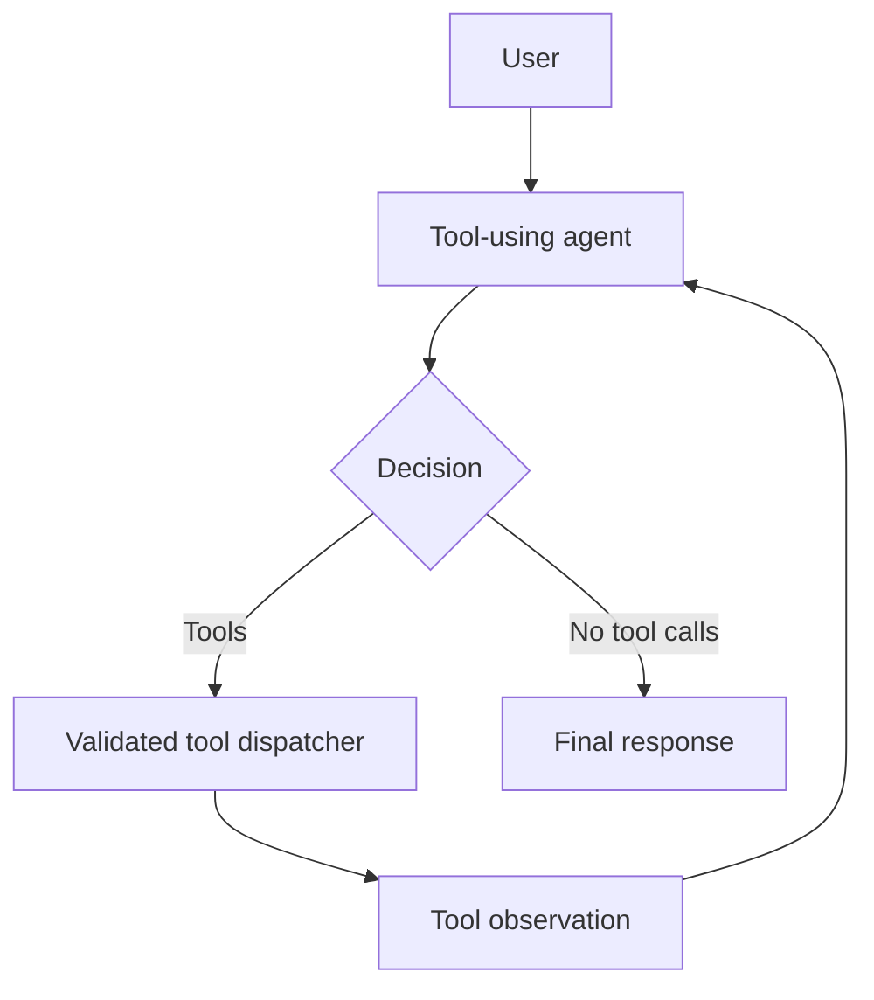
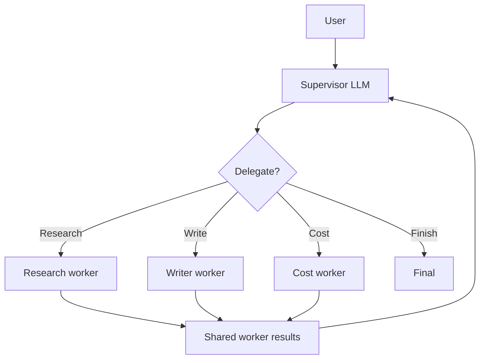
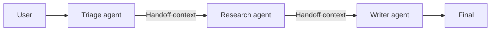
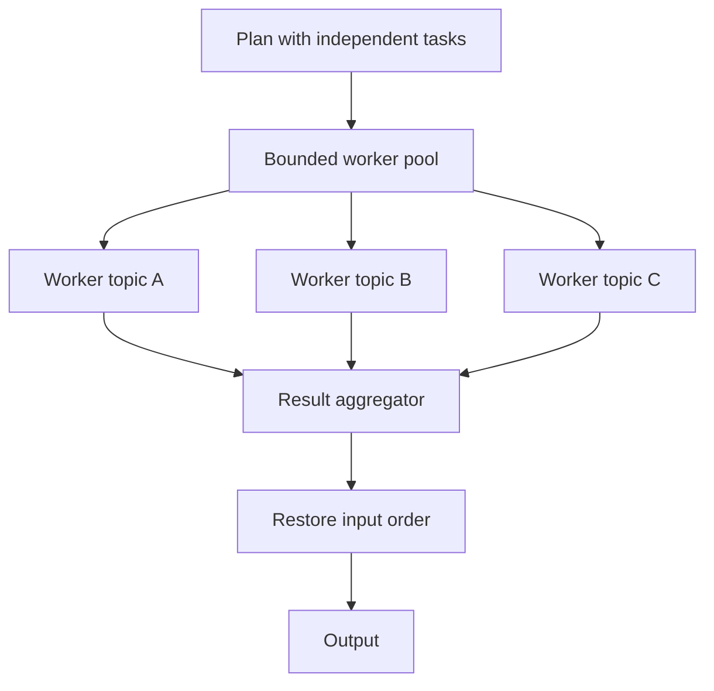
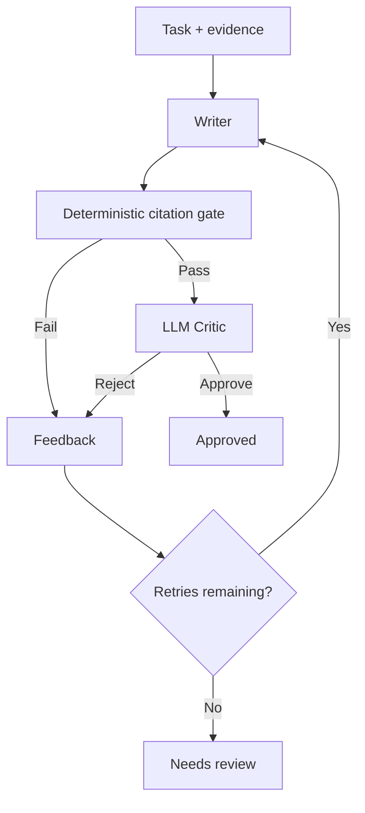
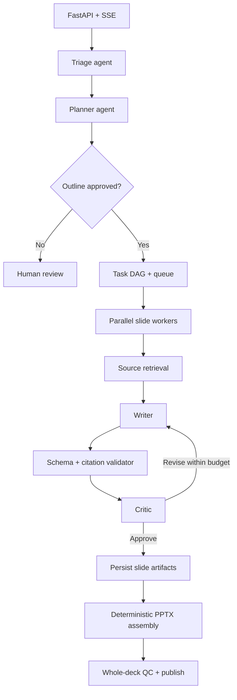

# Lesson 2 — Detailed Architecture Design Notes

## Core terms

- **Agent**: program that uses a model to select a task action, optionally with tools.
- **Worker**: a specialized executable unit; it can be model-powered OR deterministic.
- **Orchestrator**: application-level controller governing order, dependencies, budgets, retries, state.
- **Tool**: capability with a constrained interface that application code executes.
- **Routing**: selecting a handler for a request.
- **Handoff**: transferring active responsibility/context to another handler.
- **Critic**: evaluator that assesses a draft and returns quality feedback.

An architecture can combine several patterns. Supervisor, handoff, parallel and critic are not mutually exclusive.

## 1. Single-agent design

**State**: `messages`, tool schemas, `step_count`, `call_count`, `trace`.

**Input**: User text, developer instructions, known tools.

**Decision**: The model chooses whether to call tools or answer.

**Action**: Python validates the requested name and JSON arguments, executes an allowlisted function, feeds tool output back as tool messages.

**Termination**: No tool calls and nonempty answer, or step/call budget exceeded.

**Common failure**: Hallucinated tool names, malformed JSON, repeated identical calls, expensive long loops, unauthorized requests.

**Production improvements**: per-tool permission checks, idempotency keys for side effects, traces, externalized state, timeouts, confirmation for sensitive actions.

## 2. Supervisor design

**Supervisor has authority** to choose among workers, but does NOT get arbitrary code execution access. Its choices must belong to a worker allowlist.

**Shared state** includes user request and immutable or append-only worker results. Workers should receive only relevant context.

**Compare to fixed workflow**: A fixed workflow invokes researcher → writer → cost in a known order. A Supervisor may omit cost for a nonpricing question or choose additional research (with a different policy than this demo). The actual local model makes the decision at runtime; the mock demonstrates the path deterministically.

**Complexity**: Every delegation round trip adds model latency; avoid supervisor routing on trivial transitions that code already knows.

**Dependency validation**: E.g., never write a grounded slide before research evidence exists. Application enforces the policy even if the supervisor's proposed delegation is invalid.

**Common failure**: Supervisor delegates repeatedly, chooses wrong specialist, floods shared context, forgets output quality, or overuses model calls.

## 3. Handoff design

**Control ownership**: The currently active agent owns the next action. Once it hands off, a new agent becomes active; no central supervisor must be invoked on each turn.

**Carry across**: Request, structured handoff payload, source references, relevant prior messages, user approval requirements, correlation ID.

**Handoff policy**: Define `ALLOWED` transition graph. Don't allow unconstrained target strings. Reject illegal transitions and enforce a maximum number of hops.

**Potential complexity**: A human reply must be delivered to the current agent, not blindly to the original triage agent. Production systems need persistent `active_agent` state per thread/job.

**Common failure**: A hands to B who returns to A forever, context loss, conflicting agent instructions, wrong permission inheritance.

## 4. Parallel worker design

**Execution scheduling is usually deterministic**, not model-driven. Agents can generate the plan, but launching each independent job is ordinary application logic.

**Concurrency budget**: `max_workers` controls in-flight tasks. Increasing it is not guaranteed to improve local Ollama throughput because GPU/CPU contention, memory pressure and runtime request handling are limiting factors.

**Task state**: `task_id`, `topic`, `input_hash`, `status`, `attempts`, `artifact_path`, `duration_ms`, `error`.

**Failure isolation**: Collect successful task results even if one task fails. Record failed tasks separately; retry only failed work.

**Order**: Completion order is not presentation order. Use stable task indexes and sort after aggregation.

**Dependencies**: If B depends on A, schedule A first and release B only once A succeeds. This leads toward a DAG scheduler.

**Scale-up path**: move from `ThreadPoolExecutor` to a durable queue + worker deployment (Celery/Redis, cloud jobs, etc.), persist results to Blob or filesystem with job IDs.

## 5. Critic / evaluator-optimizer design

**Hard rules** live in code: required citations, valid source IDs, supported format, known output path, required schemas, authorization. 

**Soft criteria** can use LLM assessment: clarity, helpfulness, completeness, slide flow, tone. Always ground the critique in the task and evidence.

**Why two checks?** A model can approve incorrectly. A citation identifier can exist without supporting the actual claim. Checking the former with code is necessary but not sufficient for semantic grounding.

**Termination**: Fixed `max_revisions` and explicit `needs_review` terminal state.

**Common failure**: endless writer/critic argument, critic giving vague feedback, overediting a satisfactory output, shared blind spots when writer and critic use the same model.

## Comparison

| Pattern | Model-driven decision | Typical extra calls | Main risk | State to persist |
|---|---|---|---|---|
| Single | Tool choice | 1+ per tool round | Tool misuse | Transcript, tool calls |
| Supervisor | Worker selection | 1+ per delegation | Routing overhead | Worker ledger, decisions |
| Handoff | Next owner | 1+ per specialist | Context loss / cycles | Active agent, payloads |
| Parallel | Inside each worker; dispatch code-controlled | Number of tasks | Resource contention | Task statuses and artifacts |
| Critic | Revision judgment | Writer + critic per attempt | Endless revisions | Drafts, feedback, verdicts |

## Combined production-oriented example: generate 30 slides

**State for production**: User/tenant ID, project ID, workflow/thread ID, plan version, immutable slide task ID, dependencies, execution state, source hashes, retry budgets, artifact URI, source attribution, approval result, timestamps.

**Important**: This combination is an architecture sketch, **not implemented by the Lesson 2 Python sample**. The sample teaches components separately so their semantics are observable. Building the full diagram requires Lesson 3 (planning, graph orchestration, persistence).

## A system design interview response template

1. State task characteristics (ambiguity, independence, approval, latency, quality).
2. Choose the simplest working architecture.
3. Explain control/ownership boundaries and who can call which tools.
4. Define state and idempotency behavior for recovery.
5. Explain concurrency limits, retry budgets, and degraded behavior.
6. Define observability, validation and evaluation metrics.
7. Explain which added complexity is justified, and which is not.
